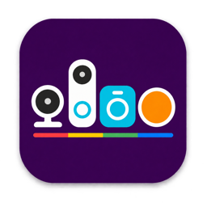

<p align="center">
  <a href="https://github.com/n0rt0nthec4t/homebridge-nest-accfactory"></a>
</p>

<h1 align="center">Nest Accfactory</h1>

<p align="center">
  <b>Your Nest devices. At home in Apple Home.</b>
</p>

<p align="center">
  
  
  
  <a href="https://github.com/homebridge/homebridge/wiki/Verified-Plugins"></a>
</p>

<p align="center">
  <a href="https://github.com/sponsors/n0rt0nthec4t"></a>
  <a href="https://www.buymeacoffee.com/n0rt0nthec4t"></a>
</p>

Connect your supported Nest and Google Home devices to Apple Home through Homebridge, with HomeKit Secure Video support for compatible cameras and doorbells.

## Getting Started

1. Install `homebridge-nest-accfactory` from the **Plugins** page in the Homebridge UI.
2. Open the plugin settings and add your [Google or Nest account credentials](#configuration).
3. For cameras and doorbells, check that [FFmpeg is installed](#ffmpeg).
4. Save the configuration and restart Homebridge, or the plugin's child bridge if configured.
5. Add the Homebridge bridge to Apple Home if it is not already paired. Follow the pairing instructions shown in the Homebridge UI.

### Requirements

- **Node.js 22 (22.12 or later) or 24.** Node.js 26 is also supported with Homebridge 2.5 or later.
- **Homebridge 1 (1.11.4 or later) or Homebridge 2 (2.5.0 or later).**
- A Nest or Google account with access to the supported devices.
- **FFmpeg 7.1 or later** for cameras and doorbells. See [FFmpeg setup](#ffmpeg) for a compatible build.

[Supported devices](#supported-devices) · [Configuration](#configuration) · [Configuration reference](#configuration-reference) · [HomeKit Secure Video](#homekit-secure-video-hksv) · [Support](#support-policy)

## Supported Devices

Supported device families include:

- Nest Thermostats
- Nest Protects
- Nest Temperature Sensors
- Nest Cameras, including floodlight cameras
- Nest Doorbells
- Nest Heat Links
- Nest × Yale Locks

The plugin also provides these **virtual accessories** in Apple Home:

- Home/Away, based on your Nest/Google home's status
- An optional weather accessory for each configured home

The features you see in Apple Home depend on your device model and what your Nest or Google account allows you to control. This plugin supports the devices listed above; it does not add other brands of devices from Google Home.

One or more Nest and Google accounts can be configured together.

**Note: Google ended online support for 1st and 2nd generation Nest Learning Thermostats on October 25, 2025. These models are no longer supported by this plugin, but can still be controlled directly on the thermostat.** [Learn more](https://support.google.com/googlehome/answer/16233096).

## Configuration

Open the plugin settings in Homebridge to add your accounts and choose settings for your homes and devices. Follow the instructions below for the account you use to sign in to Nest.

You can also edit advanced settings in `config.json`; see the [configuration reference](#configuration-reference).

Google accounts use `issueToken` and `cookie`. Legacy Nest accounts use `access_token`. Treat these credentials as passwords: do not share them in issues, screenshots, logs or configuration examples.

<a id="nest-account"></a>

### Nest Account

If you have a **Nest Account**, you’ll need to obtain an **access token** from the Nest web app.

1. Go to [home.nest.com](https://home.nest.com) and click **Sign in with Nest**.  
2. After logging in, open [home.nest.com/session](https://home.nest.com/session).  
3. You’ll see a JSON string similar to:  
   ```json
   {"2fa_state":"enrolled","access_token":"XXX"}
   ```
4. Copy the value of **access_token** near the start (a long string beginning with `b`) and paste it into the Nest account field in the plugin settings.
   - Ignore any other `access_token` entries further down the string.

**Note:** Do **not** log out of [home.nest.com](https://home.nest.com), as this will invalidate your credentials.

<a id="google-account"></a>

### Google Account

The plugin needs two sign-in details from your Google account: an `issueToken` URL and a `cookie`. Follow these Safari steps to copy them. If they expire or stop working, repeat these steps.

1. Open Safari in a **Private Window**  
2. Enable the **Develop Menu** (Safari ▸ Settings ▸ Advanced ▸ check *Show features for web developers*)  
3. Open **Develop ▸ Show Web Inspector**, then select the **Network** tab  
4. Ensure **Preserve Log** or **Preserve Requests** is checked  
5. In the filter box, type **issueToken**  
6. Go to [home.nest.com](https://home.nest.com) and click **Sign in with Google**  
7. After login, click the **iframerpc** network request  
8. In **Headers**, copy:  
   - **Summary ▸ URL** this is your **issueToken**  
   - **Request ▸ Cookie:** this is your **cookie**, which must include a key starting with **`SIDCC=`** (if `SIDCC` is missing, the cookie is incomplete and authentication will fail)
9. Paste both values into the Google account fields in the plugin settings.

**Important:** Safari is the supported browser for this capture procedure. If credentials captured using another browser fail, capture them again using Safari.

**Note:** Do **not** log out of [home.nest.com](https://home.nest.com), as this will invalidate your credentials.

### Multiple Accounts

Add an account entry in the plugin settings for each Nest or Google account you want to use. You can use both account types together. Each account needs its own sign-in details.

To temporarily skip an account, enable its `exclude` setting. Leave `fieldTest` off unless your account specifically uses Nest's test service.

## Doorbell Rings and Quiet Time

By default, doorbell alerts in Apple Home follow the indoor chime setting in Nest/Google Home: disabling the indoor
chime also stops these alerts. Set `ignoreIndoorChime` to `true` for the doorbell to receive Apple Home
notifications and Apple TV doorbell alerts while the physical chime is disabled, for example when using
Google Home speakers as your chime. This option does not change the physical chime setting.

HomePod chimes must also be enabled separately in Apple Home. Open the doorbell accessory's settings,
select **Chime on HomePod** and enable the speakers you want to use. `ignoreIndoorChime` does not enable
this setting. See [Apple's HomePod settings guide](https://support.apple.com/guide/homepod/apde6dc8093d/homepod) for more information.

Quiet Time silences doorbell alerts in Apple Home regardless of `ignoreIndoorChime`. Configure the physical chime
and Quiet Time in Nest/Google Home. The plugin no longer exposes a chime or Quiet Time switch; remove any
old `chimeSwitch`, `quietTimeSwitch` and `quietTimeDuration` options from your device configuration.

## FFmpeg

FFmpeg handles live camera video, recordings and two-way audio. You only need it if you use cameras or doorbells.

The plugin looks for FFmpeg automatically and checks that it has the features needed. If it cannot find a suitable installation, the Homebridge log explains what is missing. The [ffmpeg-for-homebridge](https://github.com/homebridge/ffmpeg-for-homebridge) project provides ready-made downloads.

If you install FFmpeg yourself, the requirements are:

- FFmpeg version **7.1** or later.
- Encoders: `libx264`, `libfdk_aac` and `libopus`.
- Decoder: `libspeex`.

If FFmpeg is installed but the plugin cannot find it, set `ffmpegPath` in the plugin settings. You can provide:

- The full path to FFmpeg, such as `/usr/local/bin/ffmpeg`
- The folder containing it, such as `/opt/homebrew/bin`
- A command name your system can run, such as `ffmpeg`

For manual configuration, add this option to your existing plugin entry:

```json
{
    "options": {
        "ffmpegPath": "/usr/local/bin/ffmpeg"
    }
}
```

To use hardware acceleration, enable `ffmpegHWAccel`. This depends on your computer and FFmpeg installation. The plugin checks whether it can use the hardware and falls back to software encoding where supported.

## HomeKit Secure Video (HKSV)

**HomeKit Secure Video (HKSV)** support is enabled for compatible Nest cameras and doorbells. Camera streaming and recording require the [FFmpeg prerequisites](#ffmpeg).

To record, configure a compatible Apple home hub and an eligible iCloud+ plan, then enable recording in the camera's Apple Home settings. See [Apple's HomeKit Secure Video setup guide](https://support.apple.com/guide/icloud/mm7c90d21583/icloud).

### Recording Settings

HKSV support does not enable continuous recording. Choose streaming and recording permissions in the Apple Home app for when people are home or away; enable recording there to use the HKSV timeline.

### Motion Events and Recording

**Turn on motion detection for your camera in the Nest or Google Home app, as well as enabling recording in Apple Home.** The plugin needs your camera to report motion before it can trigger a motion recording. Enabling recording in Apple Home alone is not enough.

Choose which events to save, such as people, animals, vehicles or packages, in Apple Home. Apple Home uses its own video analysis; the plugin does not use Nest/Google's event labels to make those choices.

<a id="custom-homekit-characteristics"></a>

## Extra Features in Other Home Apps

Some extra device information is available in compatible HomeKit apps such as [Eve](https://www.evehome.com/en-us/eve-app), even though Apple Home does not show it.

For example, you can view a Nest Protect's **Replace By Date** in a compatible app. The extra information and controls available, including support for scenes and automations, depend on your device and the app. Read-only values, such as the replacement date, cannot be changed.

## Configuration Reference

Most users can manage settings through the Homebridge UI. This section explains the options available there and the additional settings you can enter in `config.json`.

<details>
<summary>Example config.json entry for manual setup</summary>

The example below is **one plugin entry**, placed inside Homebridge's `platforms` list. Include only the accounts you use and replace the placeholder sign-in details.

```json
{
    "accounts": [
        {
            "name": "Nest",
            "type": "nest",
            "access_token": "<nest access token>"
        },
        {
            "name": "Google",
            "type": "google",
            "issueToken": "<google issue token>",
            "cookie": "<google cookie>"
        }
    ],
    "options": {
        "eveHistory": true,
        "debug": false
    },
    "homes": [
        {
            "name": "Main Home",
            "elevation": 321,
            "weather": true
        }
    ],
    "devices": [
        {
            "serialNumber": "XXXXXXXX",
            "name": "XXXXX Device",
            "exclude": false
        },
        {
            "serialNumber": "YYYYYYYY",
            "name": "YYYYY Device",
            "humiditySensor": true
        }
    ],
    "platform": "NestAccfactory"
}
```

</details>

### Global Options

These settings apply to all devices unless you choose a different setting for an individual device. In `config.json`, place them under `"options"`.

| Name                 | Description                                                                                    | Default             |
| -------------------- | ---------------------------------------------------------------------------------------------- | ------------------- |
| debug                | Show detailed plugin logs for troubleshooting; separate from Homebridge's debug setting      | false               |
| eveHistory           | Show supported device history in the Eve app                                                   | true                |
| exclude              | Exclude all devices from Apple Home                                                            | false               |
| ffmpegDebug          | Collect camera troubleshooting details; also enable `debug` to see the logs                   | false               |
| ffmpegHWAccel        | Enable video hardware acceleration for camera(s) and doorbell(s) where supported               | false               |
| ffmpegPath           | Where to find FFmpeg; leave unset to let the plugin find it automatically                     | Automatic detection |
| ffmpegTranscode      | Re-encode live camera video for compatibility; uses more CPU                                   | false               |
| logMotionEvents      | Enable logging of motion events for camera(s), doorbell(s) and Nest Protect device(s)          | true                |
| maxStreams           | Maximum simultaneous live views per camera (1–4)                                              | 2                   |
| supportDump          | Log Nest/Google device data to help investigate a problem                                      | false               |

Use `supportDump` when requested for troubleshooting. These dumps hide sign-in details, personal information, network addresses and camera URLs. Other logs can still include device names and identifiers, so check them before sharing.

### Device Overrides

Use **Device Settings** in the Homebridge UI to change settings for one device. Some advanced options are only available by editing the `"devices"` list in `config.json`.

For most settings, a device's setting takes priority over the global setting. The camera options `ffmpegDebug`, `ffmpegHWAccel` and `ffmpegTranscode` work differently: if enabled globally, they stay enabled for every camera. To use one of these options for selected cameras only, turn it off globally and enable it on those devices.

Identify each device using the `serialNumber` shown in Nest or Google Home. Copy it as shown; upper- and lower-case letters are treated the same.

The `"name"` field is optional and is only used to help identify the entry in the configuration. It does **not** rename the device in Apple Home.

| Name                 | Description                                                                                    | Default                      |
| -------------------- | ---------------------------------------------------------------------------------------------- | ---------------------------- |
| doorbellCooldown     | Time between doorbell press events                                                             | 60s                          |
| eveHistory           | Provide Eve history where supported                                                            | Inherits global setting      |
| exclude              | Exclude this device; explicit `false` can include it despite a home/global exclusion           | Inherits home/global setting |
| fanDuration          | Thermostat fan runtime, rounded to a supported Nest preset                                     | Device-reported duration     |
| ffmpegDebug          | Collect camera troubleshooting details; also enable global `debug` to see the logs            | false                        |
| ffmpegHWAccel        | Enable video hardware acceleration for camera(s) and doorbell(s) where supported               | false                        |
| ffmpegTranscode      | Re-encode live camera video for compatibility; uses more CPU                                   | false                        |
| hotwaterBoostTime    | Heat Link hot-water boost duration, rounded to 30, 60 or 120 minutes                           | `30m`                        |
| hotwaterMaxTemp      | Upper hot-water target limit in °C, where temperature control is supported                     | 70                           |
| hotwaterMinTemp      | Lower hot-water target limit in °C, where temperature control is supported                     | 30                           |
| humiditySensor       | Enable a separate humidity sensor for thermostat(s) where supported                            | false                        |
| ignoreIndoorChime    | Allow doorbell alerts in Apple Home when the indoor chime is disabled                         | false                        |
| logMotionEvents      | Log supported camera, doorbell and Nest Protect motion events                                  | Inherits global setting      |
| motionCooldown       | Time between detected motion events                                                            | 60s                          |
| name                 | Optional label to help identify this device entry                                              |                              |
| serialNumber         | Device serial number this configuration applies to                                             |                              |

Duration options accept strings such as `"60s"`, `"30m"` or `"1h"`. Plain numeric strings are interpreted as seconds. Camera motion and doorbell cooldowns are limited to 0–300 seconds. Hot-water temperature limits are numeric values in °C, without a unit suffix (for example `"70"`).

### Home Settings

Use **Home Settings** in the Homebridge UI to enable weather information or exclude devices in a particular home. If editing `config.json`, add an entry to `"homes"` using the home's name from Nest or Google Home. Upper- and lower-case letters and spaces at the start or end of the name are ignored.

| Name                 | Description                                                                                    | Default                 |
| -------------------- | ---------------------------------------------------------------------------------------------- | ----------------------- |
| elevation            | Weather-station elevation in metres above sea level, from 0 to 8848                            | 0                       |
| name                 | Home name from Nest/Google Home                                                                | Required                |
| exclude              | Exclude devices in this home unless explicitly included by a device override                   | Inherits global setting |
| weather              | Virtual weather station for this Home                                                          | false                   |

## Support Policy

Support covers the official **`homebridge-nest-accfactory`** package maintained by **n0rt0nthec4t**, used with **Apple Home through Homebridge**. Integration with other smart-home platforms is outside this project's scope.

For forks, renamed packages or modified versions, contact their maintainer. These versions are not endorsed or supported here. If the same problem occurs with the official package in a supported Homebridge installation, you can report it in [this repository](https://github.com/n0rt0nthec4t/homebridge-nest-accfactory).

### Supported Environments

Supported environments include Homebridge installations running on common platforms such as Linux or macOS, as well as official container or image distributions such as **docker-homebridge**, **homebridge-vm-image**, and **homebridge-raspbian-image**.

Platforms that bundle, modify, or wrap Homebridge — including **HOOBS**, **Home Assistant add-ons that bundle Homebridge**, and similar third-party environments — are **not officially supported**. Issues specific to unsupported environments may be closed without investigation.

### Reporting Issues

If you encounter a problem, please [raise an issue](https://github.com/n0rt0nthec4t/homebridge-nest-accfactory/issues) on the project's **GitHub repository**.

Before submitting an issue, please confirm that you are using the official **`homebridge-nest-accfactory`** package in a supported Homebridge environment.

Include:

- Your plugin and Homebridge versions, Node.js version and operating system.
- The affected device model and what you expected to happen.
- What happened instead and the steps needed to repeat the problem.
- Relevant logs, with sign-in details and any personal information removed.

For camera problems, also include your FFmpeg version and whether the problem affects live view, recordings or two-way audio.

<details>
<summary>Collecting extra logs for troubleshooting</summary>

For camera timing problems:

1. Turn on global `debug` in the plugin settings.
2. Turn on `ffmpegDebug` globally or for the affected camera.
3. Reproduce the problem, then close the live view or recording.
4. Include the `Media timing` and `Media delivery` summaries from the log.

Enable `supportDump` separately if requested for a Nest/Google account or device-data problem. Turn these troubleshooting options off when finished. Support dumps hide sensitive API data, but other logs can still contain device names and identifiers. Check all logs before sharing them.

</details>

Feature requests and enhancements are welcome, but please keep in mind that this is a personal open-source project maintained in spare time.

## Development and Verification

Want to contribute code? See [CONTRIBUTING.md](CONTRIBUTING.md) for development setup, test commands and contribution guidelines, including what automated checks can and cannot verify.

## Disclaimer

This is a personal hobby project provided **"as-is"**, with no warranty whatsoever, express or implied, including but not limited to warranties of merchantability or fitness for a particular purpose.

This is an independent project and is not affiliated with or endorsed by Apple or Google. The author of this project shall not be held liable for any damages or issues arising from its use.

Apple, Apple Home and HomeKit are trademarks of Apple Inc. Google, Google Home and Nest are trademarks of Google LLC or its affiliates. Other trademarks belong to their respective owners.
